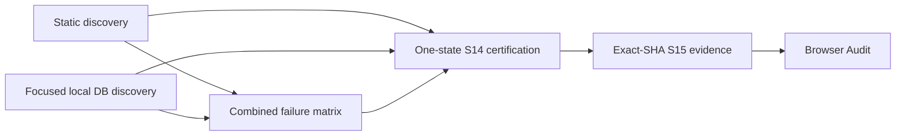

# Solaris V3 release cascade

Discovery is independent of certification. No preflight artifact is S14/S15 release evidence.

Run repository discovery with the pinned Bun runner and an explicitly empty environment file:

```sh
bun --env-file=/dev/null run scripts/v3-release-preflight.ts --group=static
```

Run database discovery only on an already started, disposable local Supabase:

```sh
bun --env-file=/dev/null run scripts/v3-release-preflight.ts --group=database
```

Both API and database targets are verified immediately before each DB check and reset. Inherited hosted targets fail closed. The workspace's previous Docker storage failure is not solved by retrying the full rehearsal; use the isolated focused Actions job when local Docker is unavailable.

Each group emits `v3-release-preflight/<group>/preflight-summary.json` and individual logs. Discovery continues after independent failures. Build-dependent budget/type checks are blocked if the build fails; an invalid stateful fixture is never continued. SQL regressions roll back. Persistent voting/Archive suites reset the **local** database before execution, using the same running stack/images. Real handoff Auth users are removed in `finally`.

The combined report checks group completeness, clean source, exact candidate identity, and duplicate/conflicting results. It retains every finding and an owner audit. Dirty local reports remain development discovery and cannot become clean exact-head certification.

## Job dependency graph



Static and focused jobs have no dependency on one another. The full S14 job requires both and the combined summary to pass. It retains one database, one edition, every canonical stage, immediate failure on invalid state, all failure injections and the original exact-SHA evidence validator. S15 evidence is generated only after successful exact-head S14; its builder also independently verifies that prerequisite. Release-related Browser Audit is called as a reusable workflow after successful same-head S14/S15 certification and validates those artifacts; it does not depend on a trigger being installed on main. It also runs or on an explicit final manual invocation/main push. Ordinary UI-only PRs retain their existing audits; the lightweight browser gate reads the canonical S14 path inventory instead of copying it. Discovery does not publish S15 release evidence.

## Initial discovery matrix

Starting source: `49c729cb8adc470a6a6e42a51323243545ce8072`. Fresh main: `06653e0adcc9cf4d09ea21b78dcf9c9ce7dbd03a`.

| Group | Check | Initial evidence | Classification |
| --- | --- | --- | --- |
| A | S15 readiness | FAIL: 124 cutovers (43 Public, 81 Organizer) | N: release cutover incomplete; ownership mapped |
| A | Physical ownership | PASS: 149 tables, 10 explicit shared owners, no conflicts | No defect |
| A | Capability/non-route/System registries; migration adoption; structural release integrity | PASS | Structural validity only |
| A | Repository release-integrity blockers | FAIL: 40 declared-only consequences; three parity evidence references missing | L/D: unproven consequence implementation and missing metadata; previously non-fatal warnings |
| A/C | Existing S14/S15/release contracts | PASS: 256 tests | No defect |
| A | Quality, budget/type/lint | PASS on starting exact-head CI | No defect |
| B | Results lineup, qualification, runtime ACL SQL | PASS: starting S14 job steps 10–12 | No defect; transactional fixtures |
| B | Voting truth, S7 Jury scope, Archive focused suite | PASS: starting exact-head workflows | No defect; see fixture limitations below |
| C | Published Results -> qualification -> final preparation | GAP: qualification fixture stopped before review/lock/reveal/publication | F/G: missing faithful boundary coverage; new optional transaction suite |
| C | Version/receipt/worker/evidence writer regressions | PASS: executable minimized regressions from previous S14 surprises | Retained |
| D | Full one-state S14 and exact-SHA S14 evidence | PASS: run 40213231583, steps 14–15 | No lifecycle defect |
| D | Late S15 certification | FAIL: same 124 repository-derived cutovers discovered only after S14 | K: orchestration defect; discover early now |
| Integration | Current-main merge | Conflict plus stale PNG routing assertion; main raised aggregate budget to 2200 KiB | J/H: integrate vectors, preserve original 1800 KiB, correct obsolete asset assertion |
| Safety | Local Bun default `.env` | Hosted URL detected, executable checks blocked before use | Guard works; explicit empty env file required |

No required gate is waived. In particular, the 124 findings below must not be changed to `cutover`/`retired` merely to unblock CI. Existing ownership checks pass; the scanner correctly reports the declared cutover statuses. Proving cutover needs each capability's actual acceptance/migration evidence, beyond the contest lifecycle fixture. No scanner false positive has been established.

## Focused fixture and handoff audit

| Existing coverage | State construction / authority | Boundary coverage / limitation |
| --- | --- | --- |
| Results lineup SQL | Seed unpublished fixture; canonical participation preview/apply; guarded calculate/replay; rollback | Current identity/cardinality, immutable snapshot and idempotency; disables voting for this owner-level case |
| Qualification SQL | Two semis plus separate automatic finalist; canonical calculate and withdrawal/disqualification; rollback | 20 distinct/10 each, rank 10/11, history and refresh idempotency; previously lacked published lifecycle state |
| Integration runtime SQL | Actual service role; binding ACL/read/freeze and event upsert/replay; rollback | ACL/RLS boundary, not publication lifecycle |
| Voting truth rehearsal | Seed versioned voting source fixtures; canonical projection/readiness/reconciliation | Source-version/cardinality contracts; it does not replace real browser publication in S14 |
| Existing Grand Final contracts | Product source contracts, real selection helper test, strict versioned-operation double | Captures selection loading, version 0/66 handoff, receipts/worker contexts; real browser remains final integration proof |
| Archive System rehearsal | Seeds exact finalized/published source state, then canonical transition/consumer | Good Archive ownership/guard coverage; initial Results/publication rows are fixtures rather than full upstream operations |
| New publication handoff | Reuses qualification fixture; real local GoTrue password session; canonical review/lock/reveal/publication; authenticated Organizer participant insertion; final calculate/finalize/publish; canonical Results/post/Archive transitions and receipts/worker | Narrows Stage8 -> qualifiers -> final assembly -> final publication -> Archive -> composite outbox evidence without confirmations, entries, public ballots or a full contest |
| Evidence writer regression | Executes actual writer with strict schema-query double | Detects outbox composite-key assumption, all stages/extensions and output identity; real archived persisted truth is covered by the new handoff and S14 |

Entries -> Voting remains covered by confirmed-lineup source contracts plus scoped Jury/Vote regressions. Voting -> Results is the focused voting-truth suite. Published Results -> Qualification -> Final preparation and Final Results -> Publication -> Archive -> Evidence are strengthened by the new handoff. The full S14 remains the only complete real-voting/browser/lifecycle certification; focused tests never substitute its state.

## Complete initial S15 finding audit

Every row has a discovered capability and mapped canonical owner. Its recorded status is below the unchanged `cutover`/`retired` release requirement. Classification is `N_RELEASE_CUTOVER_INCOMPLETE`, not a missing physical owner. Registry/discovery checks found no stale owner mapping. No readiness status is promoted by this change.

| Exact finding | Canonical owner(s) | Target artifact | Registry source |
| --- | --- | --- | --- |
| `PUBLIC_CUTOVER_UNRESOLVED participant-view:building` | `participation`, `task` | `/participate` | `src/lib/v3-public-capability-registry.ts + v3-public-capability-supplements.ts` |
| `PUBLIC_CUTOVER_UNRESOLVED entry:building` | `entry`, `media` | `/participate` | `src/lib/v3-public-capability-registry.ts + v3-public-capability-supplements.ts` |
| `PUBLIC_CUTOVER_UNRESOLVED participant-voting-overview:building` | `jury`, `televote`, `participation` | `/participate` | `src/lib/v3-public-capability-registry.ts + v3-public-capability-supplements.ts` |
| `PUBLIC_CUTOVER_UNRESOLVED official-notices:building` | `notice`, `notification` | `/notifications` | `src/lib/v3-public-capability-registry.ts + v3-public-capability-supplements.ts` |
| `PUBLIC_CUTOVER_UNRESOLVED country-profile:building` | `country-profile`, `country-identity` | `/countries/:country` | `src/lib/v3-public-capability-registry.ts + v3-public-capability-supplements.ts` |
| `PUBLIC_CUTOVER_UNRESOLVED delegation-history:mapped` | `delegation`, `activity` | `/my-solaris/history` | `src/lib/v3-public-capability-registry.ts + v3-public-capability-supplements.ts` |
| `PUBLIC_CUTOVER_UNRESOLVED participant-activity:building` | `activity` | `/my-solaris/activity` | `src/lib/v3-public-capability-registry.ts + v3-public-capability-supplements.ts` |
| `PUBLIC_CUTOVER_UNRESOLVED predictions:mapped` | `prediction`, `community-profile` | `/predictions` | `src/lib/v3-public-capability-registry.ts + v3-public-capability-supplements.ts` |
| `PUBLIC_CUTOVER_UNRESOLVED saved-items:building` | `personal-preference` | `/my-solaris/saved` | `src/lib/v3-public-capability-registry.ts + v3-public-capability-supplements.ts` |
| `PUBLIC_CUTOVER_UNRESOLVED country-account:building` | `delegation`, `identity`, `session` | `/my-solaris/account` | `src/lib/v3-public-capability-registry.ts + v3-public-capability-supplements.ts` |
| `PUBLIC_CUTOVER_UNRESOLVED confirmations:parity` | `confirmation`, `participation` | `/participate` | `src/lib/v3-public-capability-registry.ts + v3-public-capability-supplements.ts` |
| `PUBLIC_CUTOVER_UNRESOLVED jury:parity` | `jury`, `participation` | `/participate` | `src/lib/v3-public-capability-registry.ts + v3-public-capability-supplements.ts` |
| `PUBLIC_CUTOVER_UNRESOLVED televote:parity` | `televote` | `/participate` | `src/lib/v3-public-capability-registry.ts + v3-public-capability-supplements.ts` |
| `PUBLIC_CUTOVER_UNRESOLVED next-in-line:mapped` | `next-in-line` | `/next-in-line` | `src/lib/v3-public-capability-registry.ts + v3-public-capability-supplements.ts` |
| `PUBLIC_CUTOVER_UNRESOLVED integrity-report:mapped` | `integrity` | `/integrity/report` | `src/lib/v3-public-capability-registry.ts + v3-public-capability-supplements.ts` |
| `PUBLIC_CUTOVER_UNRESOLVED rules:building` | `rules` | `/rules` | `src/lib/v3-public-capability-registry.ts + v3-public-capability-supplements.ts` |
| `PUBLIC_CUTOVER_UNRESOLVED results:building` | `results`, `publication` | `/results` | `src/lib/v3-public-capability-registry.ts + v3-public-capability-supplements.ts` |
| `PUBLIC_CUTOVER_UNRESOLVED live-show:mapped` | `live-show`, `publication` | `/show-mode` | `src/lib/v3-public-capability-registry.ts + v3-public-capability-supplements.ts` |
| `PUBLIC_CUTOVER_UNRESOLVED fantasy:mapped` | `fantasy`, `results` | `/fantasy` | `src/lib/v3-public-capability-registry.ts + v3-public-capability-supplements.ts` |
| `PUBLIC_CUTOVER_UNRESOLVED fan-public-identity:mapped` | `community-profile` | `/my-solaris` | `src/lib/v3-public-capability-registry.ts + v3-public-capability-supplements.ts` |
| `PUBLIC_CUTOVER_UNRESOLVED push-delivery:building` | `notification` | `/notifications` | `src/lib/v3-public-capability-registry.ts + v3-public-capability-supplements.ts` |
| `PUBLIC_CUTOVER_UNRESOLVED public-ux-diagnostics:mapped` | `public-ux` | `/` | `src/lib/v3-public-capability-registry.ts + v3-public-capability-supplements.ts` |
| `PUBLIC_CUTOVER_UNRESOLVED app-shell:parity` | `public-ux` | `/` | `src/lib/v3-public-capability-registry.ts + v3-public-capability-supplements.ts` |
| `PUBLIC_CUTOVER_UNRESOLVED explore-root:building` | `edition`, `country-profile`, `results` | `/explore` | `src/lib/v3-public-capability-registry.ts + v3-public-capability-supplements.ts` |
| `PUBLIC_CUTOVER_UNRESOLVED edition-hub:building` | `edition`, `publication` | `/editions/:edition` | `src/lib/v3-public-capability-registry.ts + v3-public-capability-supplements.ts` |
| `PUBLIC_CUTOVER_UNRESOLVED global-search:parity` | `public-ux`, `edition`, `country-profile`, `results` | `/search` | `src/lib/v3-public-capability-registry.ts + v3-public-capability-supplements.ts` |
| `PUBLIC_CUTOVER_UNRESOLVED scoreboard:mapped` | `results`, `publication` | `/results` | `src/lib/v3-public-capability-registry.ts + v3-public-capability-supplements.ts` |
| `PUBLIC_CUTOVER_UNRESOLVED delegation-detail:building` | `delegation`, `country-profile` | `/countries/:country` | `src/lib/v3-public-capability-registry.ts + v3-public-capability-supplements.ts` |
| `PUBLIC_CUTOVER_UNRESOLVED authentication:mapped` | `identity`, `session` | `/auth` | `src/lib/v3-public-capability-registry.ts + v3-public-capability-supplements.ts` |
| `PUBLIC_CUTOVER_UNRESOLVED prediction-league:mapped` | `prediction`, `community-profile` | `/predictions` | `src/lib/v3-public-capability-registry.ts + v3-public-capability-supplements.ts` |
| `PUBLIC_CUTOVER_UNRESOLVED result-lab:mapped` | `results`, `publication` | `/results` | `src/lib/v3-public-capability-registry.ts + v3-public-capability-supplements.ts` |
| `PUBLIC_CUTOVER_UNRESOLVED broadcast-intelligence:mapped` | `results`, `jury` | `/broadcast-intelligence/jury` | `src/lib/v3-public-capability-registry.ts + v3-public-capability-supplements.ts` |
| `PUBLIC_CUTOVER_UNRESOLVED result-relationships:mapped` | `results` | `/results` | `src/lib/v3-public-capability-registry.ts + v3-public-capability-supplements.ts` |
| `PUBLIC_CUTOVER_UNRESOLVED stories:mapped` | `story`, `edition`, `publication` | `/explore` | `src/lib/v3-public-capability-registry.ts + v3-public-capability-supplements.ts` |
| `PUBLIC_CUTOVER_UNRESOLVED scorecharts:mapped` | `results` | `/results` | `src/lib/v3-public-capability-registry.ts + v3-public-capability-supplements.ts` |
| `PUBLIC_CUTOVER_UNRESOLVED pulse:mapped` | `activity`, `notification`, `personal-preference`, `prediction`, `public-ux` | `/pulse` | `src/lib/v3-public-capability-registry.ts + v3-public-capability-supplements.ts` |
| `PUBLIC_CUTOVER_UNRESOLVED taste-dna:discovered` | `personal-preference`, `results` | `/taste-dna` | `src/lib/v3-public-capability-registry.ts + v3-public-capability-supplements.ts` |
| `PUBLIC_CUTOVER_UNRESOLVED records:mapped` | `results` | `/results` | `src/lib/v3-public-capability-registry.ts + v3-public-capability-supplements.ts` |
| `PUBLIC_CUTOVER_UNRESOLVED sitemap:parity` | `public-ux`, `edition`, `country-profile`, `results` | `/sitemap.xml` | `src/lib/v3-public-capability-registry.ts + v3-public-capability-supplements.ts` |
| `PUBLIC_CUTOVER_UNRESOLVED country-hub:mapped` | `delegation`, `country-profile`, `media`, `notice` | `/my-solaris` | `src/lib/v3-public-capability-registry.ts + v3-public-capability-supplements.ts` |
| `PUBLIC_CUTOVER_UNRESOLVED me-route:mapped` | `identity`, `participation`, `personal-preference` | `/my-solaris` | `src/lib/v3-public-capability-registry.ts + v3-public-capability-supplements.ts` |
| `PUBLIC_CUTOVER_UNRESOLVED beta-test-feedback:mapped` | `public-ux` | `/beta-test` | `src/lib/v3-public-capability-registry.ts + v3-public-capability-supplements.ts` |
| `PUBLIC_CUTOVER_UNRESOLVED terraos-teaser-preview:parity` | `public-ux` | `/terraos-teaser-preview` | `src/lib/v3-public-capability-registry.ts + v3-public-capability-supplements.ts` |
| `ORGANIZER_CUTOVER_UNRESOLVED current-edition-overview:parity` | `overview`, `edition.read` | `/admin/operations` | `src/lib/v3-organizer-capability-registry.ts` |
| `ORGANIZER_CUTOVER_UNRESOLVED current-edition-tasks:building` | `tasks-operations`, `edition.read` | `/admin/tasks` | `src/lib/v3-organizer-capability-registry.ts` |
| `ORGANIZER_CUTOVER_UNRESOLVED current-edition-delegations:building` | `delegations`, `delegation.read` | `/admin/control` | `src/lib/v3-organizer-capability-registry.ts` |
| `ORGANIZER_CUTOVER_UNRESOLVED current-edition-contest:building` | `contest`, `edition.read` | `/admin/more` | `src/lib/v3-organizer-capability-registry.ts` |
| `ORGANIZER_CUTOVER_UNRESOLVED current-edition-host:building` | `contest`, `host.read` | `/admin/hosts` | `src/lib/v3-organizer-capability-registry.ts` |
| `ORGANIZER_CUTOVER_UNRESOLVED current-edition-voting:building` | `voting-results`, `voting.read` | `/admin/control` | `src/lib/v3-organizer-capability-registry.ts` |
| `ORGANIZER_CUTOVER_UNRESOLVED current-edition-voting-declarations:building` | `voting-results`, `voting.read` | `/televoting/admin/integrity-declarations` | `src/lib/v3-organizer-capability-registry.ts` |
| `ORGANIZER_CUTOVER_UNRESOLVED current-edition-results:building` | `voting-results`, `results.preview` | `/admin/control` | `src/lib/v3-organizer-capability-registry.ts` |
| `ORGANIZER_CUTOVER_UNRESOLVED current-edition-storytelling:building` | `engagement-editorial`, `story.read` | `/admin/storytelling` | `src/lib/v3-organizer-capability-registry.ts` |
| `ORGANIZER_CUTOVER_UNRESOLVED current-edition-publish:building` | `voting-results`, `publishing.read` | `/admin/control` | `src/lib/v3-organizer-capability-registry.ts` |
| `ORGANIZER_CUTOVER_UNRESOLVED current-edition-broadcast:building` | `production`, `broadcast.read` | `/admin/control` | `src/lib/v3-organizer-capability-registry.ts` |
| `ORGANIZER_CUTOVER_UNRESOLVED operations-control-room:building` | `live-production`, `edition.read` | `/admin/control-room` | `src/lib/v3-organizer-capability-registry.ts` |
| `ORGANIZER_CUTOVER_UNRESOLVED operations-workflows:building` | `tasks-operations`, `edition.read` | `/admin/workflows` | `src/lib/v3-organizer-capability-registry.ts` |
| `ORGANIZER_CUTOVER_UNRESOLVED operations-incidents:building` | `live-production`, `edition.read` | `/admin/control-room` | `src/lib/v3-organizer-capability-registry.ts` |
| `ORGANIZER_CUTOVER_UNRESOLVED operations-eligibility:building` | `contest`, `delegation.read` | `/admin/control` | `src/lib/v3-organizer-capability-registry.ts` |
| `ORGANIZER_CUTOVER_UNRESOLVED operations-media-assets:building` | `contest`, `publishing.read` | `/admin/control` | `src/lib/v3-organizer-capability-registry.ts` |
| `ORGANIZER_CUTOVER_UNRESOLVED operations-communications:building` | `communications`, `communications.read` | `/admin/control` | `src/lib/v3-organizer-capability-registry.ts` |
| `ORGANIZER_CUTOVER_UNRESOLVED live-review-reveal-director:building` | `live-production`, `results.preview` | `/admin/results-reveal` | `src/lib/v3-organizer-capability-registry.ts` |
| `ORGANIZER_CUTOVER_UNRESOLVED live-review-broadcast-rundown:building` | `live-production`, `broadcast.read` | `/admin/control-room` | `src/lib/v3-organizer-capability-registry.ts` |
| `ORGANIZER_CUTOVER_UNRESOLVED live-review-simulation-lab:building` | `specialist-labs`, `edition.read` | `/admin/edition-simulator` | `src/lib/v3-organizer-capability-registry.ts` |
| `ORGANIZER_CUTOVER_UNRESOLVED live-review-time-machine:building` | `specialist-labs`, `edition.read` | `/admin/time-machine` | `src/lib/v3-organizer-capability-registry.ts` |
| `ORGANIZER_CUTOVER_UNRESOLVED live-review-voting-lab:building` | `specialist-labs`, `voting.read` | `/admin/voting-lab` | `src/lib/v3-organizer-capability-registry.ts` |
| `ORGANIZER_CUTOVER_UNRESOLVED delegation-confirmation-overview:building` | `delegations`, `confirmation.read` | `/admin/control` | `src/lib/v3-organizer-capability-registry.ts` |
| `ORGANIZER_CUTOVER_UNRESOLVED delegation-confirmation-requirements:building` | `delegations`, `confirmation.read` | `/admin/control` | `src/lib/v3-organizer-capability-registry.ts` |
| `ORGANIZER_CUTOVER_UNRESOLVED delegation-confirmation-responses:building` | `delegations`, `confirmation.read` | `/admin/control` | `src/lib/v3-organizer-capability-registry.ts` |
| `ORGANIZER_CUTOVER_UNRESOLVED delegation-next-in-line:building` | `delegations`, `delegation.read` | `/admin/next-in-line` | `src/lib/v3-organizer-capability-registry.ts` |
| `ORGANIZER_CUTOVER_UNRESOLVED delegation-responses-by-country:building` | `delegations`, `confirmation.read` | `/admin/control` | `src/lib/v3-organizer-capability-registry.ts` |
| `ORGANIZER_CUTOVER_UNRESOLVED delegation-submission-rounds:building` | `delegations`, `confirmation.read` | `/admin/control` | `src/lib/v3-organizer-capability-registry.ts` |
| `ORGANIZER_CUTOVER_UNRESOLVED delegation-calendar:building` | `delegations`, `confirmation.read` | `/admin/control` | `src/lib/v3-organizer-capability-registry.ts` |
| `ORGANIZER_CUTOVER_UNRESOLVED delegation-access:building` | `delegations`, `confirmation.read` | `/confirmations/admin/recovery-codes` | `src/lib/v3-organizer-capability-registry.ts` |
| `ORGANIZER_CUTOVER_UNRESOLVED delegation-submission-history:building` | `delegations`, `delegation.read` | `/admin/submission-versions` | `src/lib/v3-organizer-capability-registry.ts` |
| `ORGANIZER_CUTOVER_UNRESOLVED delegation-edition-links:building` | `delegations`, `confirmation.read` | `/confirmations/admin/editions` | `src/lib/v3-organizer-capability-registry.ts` |
| `ORGANIZER_CUTOVER_UNRESOLVED delegation-sync:building` | `delegations`, `confirmation.read` | `/confirmations/admin/sync` | `src/lib/v3-organizer-capability-registry.ts` |
| `ORGANIZER_CUTOVER_UNRESOLVED delegation-settings:building` | `delegations`, `confirmation.read` | `/confirmations/admin/settings` | `src/lib/v3-organizer-capability-registry.ts` |
| `ORGANIZER_CUTOVER_UNRESOLVED voting-rounds-entries:building` | `voting-results`, `voting.read` | `/admin/control` | `src/lib/v3-organizer-capability-registry.ts` |
| `ORGANIZER_CUTOVER_UNRESOLVED voting-jury:building` | `voting-results`, `voting.read` | `/admin/control` | `src/lib/v3-organizer-capability-registry.ts` |
| `ORGANIZER_CUTOVER_UNRESOLVED voting-rules:building` | `voting-results`, `voting.read` | `/admin/control` | `src/lib/v3-organizer-capability-registry.ts` |
| `ORGANIZER_CUTOVER_UNRESOLVED voting-jury-integrity:building` | `voting-results`, `voting.read` | `/admin/jury-integrity` | `src/lib/v3-organizer-capability-registry.ts` |
| `ORGANIZER_CUTOVER_UNRESOLVED voting-televote-totals:building` | `voting-results`, `voting.read` | `/admin/control` | `src/lib/v3-organizer-capability-registry.ts` |
| `ORGANIZER_CUTOVER_UNRESOLVED voting-integrity-review:building` | `voting-results`, `voting.read` | `/televoting/admin/integrity` | `src/lib/v3-organizer-capability-registry.ts` |
| `ORGANIZER_CUTOVER_UNRESOLVED voting-public-results:building` | `voting-results`, `results.preview` | `/admin/control` | `src/lib/v3-organizer-capability-registry.ts` |
| `ORGANIZER_CUTOVER_UNRESOLVED voting-intelligence:building` | `voting-results`, `voting.read` | `/televoting/admin/intelligence` | `src/lib/v3-organizer-capability-registry.ts` |
| `ORGANIZER_CUTOVER_UNRESOLVED voting-analytics:building` | `voting-results`, `voting.read` | `/televoting/admin/analytics` | `src/lib/v3-organizer-capability-registry.ts` |
| `ORGANIZER_CUTOVER_UNRESOLVED voting-combined-results:building` | `voting-results`, `voting.read` | `/televoting/admin/combined` | `src/lib/v3-organizer-capability-registry.ts` |
| `ORGANIZER_CUTOVER_UNRESOLVED voting-result-integrity:building` | `voting-results`, `results.preview` | `/televoting/admin/result-integrity` | `src/lib/v3-organizer-capability-registry.ts` |
| `ORGANIZER_CUTOVER_UNRESOLVED voting-audit-log:building` | `voting-results`, `voting.read` | `/televoting/admin/audit-log` | `src/lib/v3-organizer-capability-registry.ts` |
| `ORGANIZER_CUTOVER_UNRESOLVED voting-edition-links:building` | `voting-results`, `voting.read` | `/televoting/admin/editions` | `src/lib/v3-organizer-capability-registry.ts` |
| `ORGANIZER_CUTOVER_UNRESOLVED voting-result-backtest:building` | `voting-results`, `voting.read` | `/televoting/admin/backtest` | `src/lib/v3-organizer-capability-registry.ts` |
| `ORGANIZER_CUTOVER_UNRESOLVED voting-anti-abuse:building` | `voting-results`, `voting.read` | `/televoting/admin/anti-abuse` | `src/lib/v3-organizer-capability-registry.ts` |
| `ORGANIZER_CUTOVER_UNRESOLVED trust-investigations:building` | `governance`, `integrity.read` | `/admin/more` | `src/lib/v3-organizer-capability-registry.ts` |
| `ORGANIZER_CUTOVER_UNRESOLVED trust-rule-rulings:building` | `governance`, `integrity.read` | `/admin/more` | `src/lib/v3-organizer-capability-registry.ts` |
| `ORGANIZER_CUTOVER_UNRESOLVED trust-appeals:building` | `governance`, `integrity.read` | `/admin/more` | `src/lib/v3-organizer-capability-registry.ts` |
| `ORGANIZER_CUTOVER_UNRESOLVED trust-evidence:building` | `governance`, `integrity.read` | `/admin/integrity-evidence` | `src/lib/v3-organizer-capability-registry.ts` |
| `ORGANIZER_CUTOVER_UNRESOLVED trust-disclosure:building` | `governance`, `integrity.read` | `/admin/integrity-disclosure` | `src/lib/v3-organizer-capability-registry.ts` |
| `ORGANIZER_CUTOVER_UNRESOLVED trust-identity-access:building` | `governance`, `integrity.read` | `/admin/integrity-identity` | `src/lib/v3-organizer-capability-registry.ts` |
| `ORGANIZER_CUTOVER_UNRESOLVED trust-rules-manager:building` | `governance`, `rules.read` | `/admin/more` | `src/lib/v3-organizer-capability-registry.ts` |
| `ORGANIZER_CUTOVER_UNRESOLVED trust-interpretations:building` | `governance`, `rules.read` | `/admin/more` | `src/lib/v3-organizer-capability-registry.ts` |
| `ORGANIZER_CUTOVER_UNRESOLVED trust-public-rules:building` | `governance`, `edition.read` | `/admin/more` | `src/lib/v3-organizer-capability-registry.ts` |
| `ORGANIZER_CUTOVER_UNRESOLVED workspace-access-permissions:building` | `platform`, `permissions.read` | `/admin/access-permissions` | `src/lib/v3-organizer-capability-registry.ts` |
| `ORGANIZER_CUTOVER_UNRESOLVED workspace-administration:building` | `platform`, `edition.read` | `/admin/more` | `src/lib/v3-organizer-capability-registry.ts` |
| `ORGANIZER_CUTOVER_UNRESOLVED workspace-feature-rollout:building` | `platform`, `rollout.read` | `/admin/feature-rollout` | `src/lib/v3-organizer-capability-registry.ts` |
| `ORGANIZER_CUTOVER_UNRESOLVED workspace-all-editions:building` | `platform`, `edition.read` | `/admin/editions` | `src/lib/v3-organizer-capability-registry.ts` |
| `ORGANIZER_CUTOVER_UNRESOLVED workspace-organizer-guide:building` | `platform`, `edition.read` | `/admin/guide` | `src/lib/v3-organizer-capability-registry.ts` |
| `ORGANIZER_CUTOVER_UNRESOLVED workspace-country-accounts:building` | `delegations`, `delegation.read` | `/admin/country-accounts` | `src/lib/v3-organizer-capability-registry.ts` |
| `ORGANIZER_CUTOVER_UNRESOLVED workspace-flag-qa:building` | `product-qa`, `edition.read` | `/admin/flag-audit` | `src/lib/v3-organizer-capability-registry.ts` |
| `ORGANIZER_CUTOVER_UNRESOLVED workspace-hod-history:building` | `delegations`, `delegation.read` | `/admin/hod-history` | `src/lib/v3-organizer-capability-registry.ts` |
| `ORGANIZER_CUTOVER_UNRESOLVED workspace-community-moderation:building` | `engagement-editorial`, `community.read` | `/admin/community-moderation` | `src/lib/v3-organizer-capability-registry.ts` |
| `ORGANIZER_CUTOVER_UNRESOLVED workspace-predictions:building` | `engagement-editorial`, `edition.read` | `/admin/predictions` | `src/lib/v3-organizer-capability-registry.ts` |
| `ORGANIZER_CUTOVER_UNRESOLVED workspace-fantasy:building` | `engagement-editorial`, `edition.read` | `/admin/fantasy` | `src/lib/v3-organizer-capability-registry.ts` |
| `ORGANIZER_CUTOVER_UNRESOLVED workspace-command-assistant:building` | `specialist-labs`, `edition.read` | `/admin/command-assistant` | `src/lib/v3-organizer-capability-registry.ts` |
| `ORGANIZER_CUTOVER_UNRESOLVED workspace-anniversary-settings:building` | `engagement-editorial`, `edition.read` | `/admin/anniversary` | `src/lib/v3-organizer-capability-registry.ts` |
| `ORGANIZER_CUTOVER_UNRESOLVED workspace-anniversary-dates:building` | `engagement-editorial`, `edition.read` | `/admin/anniversary-dates` | `src/lib/v3-organizer-capability-registry.ts` |
| `ORGANIZER_CUTOVER_UNRESOLVED workspace-public-ux:building` | `product-qa`, `edition.read` | `/admin/public-ux` | `src/lib/v3-organizer-capability-registry.ts` |
| `ORGANIZER_CUTOVER_UNRESOLVED workspace-beta-3-feedback:building` | `product-qa`, `rollout.manage` | `/admin/beta3-feedback` | `src/lib/v3-organizer-capability-registry.ts` |
| `ORGANIZER_CUTOVER_UNRESOLVED workspace-beta-2-feedback:building` | `product-qa`, `rollout.manage` | `/admin/beta2-feedback` | `src/lib/v3-organizer-capability-registry.ts` |
| `ORGANIZER_CUTOVER_UNRESOLVED workspace-beta-1-archive:building` | `product-qa`, `rollout.manage` | `/admin/beta1-feedback` | `src/lib/v3-organizer-capability-registry.ts` |
| `ORGANIZER_CUTOVER_UNRESOLVED workspace-acceptance-test:building` | `product-qa`, `rollout.manage` | `/admin/beta-test` | `src/lib/v3-organizer-capability-registry.ts` |
| `ORGANIZER_CUTOVER_UNRESOLVED workspace-beta-coverage:building` | `product-qa`, `rollout.manage` | `/admin/admin-beta-feedback` | `src/lib/v3-organizer-capability-registry.ts` |
| `ORGANIZER_CUTOVER_UNRESOLVED workspace-system-health:building` | `platform`, `system.read` | `/admin/more` | `src/lib/v3-organizer-capability-registry.ts` |
| `ORGANIZER_CUTOVER_UNRESOLVED workspace-delivery-jobs:building` | `platform`, `system.read` | `/admin/system-operations` | `src/lib/v3-organizer-capability-registry.ts` |
| `ORGANIZER_CUTOVER_UNRESOLVED workspace-system-settings:building` | `platform`, `system.read` | `/admin/system` | `src/lib/v3-organizer-capability-registry.ts` |

Physical ownership findings: **none**. All other S15 finding categories: **zero** on the starting head. The runtime-generated audit also retains Public acceptance scenario IDs and every current status; it must be regenerated for a changed candidate.

#1400 remains frozen. No Results residual code is extracted or promoted by this cascade work. Numeric performance budgets remain 1050 KiB raw JS, 300 KiB gzip JS, 45 KiB single CSS, 1800 KiB aggregate JS+CSS, 15 KiB app shell CSS and 48 KiB global CSS.

## Additional repository release blockers exposed by strict discovery

The original `check-v3-release-integrity.ts` default is deliberately structural. Its successful exit also prints non-fatal release blockers. The cascade now additionally runs `--discovery --json`: it fails on **repository-derived** blockers, preserves each exact finding, and lists late certificate requirements separately. Original `--release` / `--certified` behavior is unchanged. No missing runtime artifact is treated as early proof of failure or fabricated before S14.

The initial three `PARITY_EVIDENCE_MISSING` warnings were `app-shell`, `global-search`, and `sitemap`. Their existing source/contract/browser coverage is now referenced by their canonical registry rows. Their status remains **parity**; they still appear among the 124 unresolved cutovers. This fixes missing evidence links, not a cutover claim.

There are also **40** consequences without proven transactional emission plus executable delivery. Their owners/consumers are already declared. The registry explicitly forbids interpreting that as runtime implementation. Searching exact SQL references is triage, not a substitute for execution proof. For example, `edition.transitioned` is emitted, but its emission installs an empty consumer list; the edition worker accepts `edition.archived`. Promoting it to event-backed merely because the event exists would certify undeployed consequences. No such promotion is made.

| Exact repository finding | Owner | Declared consumers | Exact SQL references (triage only) |
| --- | --- | --- | --- |
| `DOMAIN_CONSEQUENCE_DECLARED edition.changed` | `edition` | `public edition routes`, `Organizer edition workspace`, `task:edition.blocker` | none |
| `DOMAIN_CONSEQUENCE_DECLARED edition.transitioned` | `edition` | `public edition routes`, `Organizer edition workspace`, `task:edition.blocker` | `supabase/migrations/20261019112300_v3_s14_transition_http409.sql:41` |
| `DOMAIN_CONSEQUENCE_DECLARED delegation.changed` | `delegation` | `country profile`, `Organizer delegation workspace`, `task:delegation.attention` | none |
| `DOMAIN_CONSEQUENCE_DECLARED participation.changed` | `participation` | `Participant View + delegation readiness`, `task:participation.blocker` | none |
| `DOMAIN_CONSEQUENCE_DECLARED selection.reviewed` | `national-selection` | `national final/public selection`, `Organizer Selection & Entry Review`, `task:selection.review_required` | none |
| `DOMAIN_CONSEQUENCE_DECLARED selection.winner_changed` | `national-selection` | `national final/public selection`, `Organizer Selection & Entry Review`, `task:selection.review_required` | none |
| `DOMAIN_CONSEQUENCE_DECLARED task.opened` | `task` | `Organizer Tasks` | none |
| `DOMAIN_CONSEQUENCE_DECLARED task.resolved` | `task` | `Organizer Tasks` | none |
| `DOMAIN_CONSEQUENCE_DECLARED country.identity_changed` | `country-identity` | `country/Wiki/results identity`, `Organizer Country` | none |
| `DOMAIN_CONSEQUENCE_DECLARED country_profile.changed` | `country-profile` | `Country/Wiki`, `Organizer Public Profile/Appearance`, `task:country_profile.moderation` | none |
| `DOMAIN_CONSEQUENCE_DECLARED media.verified` | `media` | `processed public assets`, `Organizer Media`, `task:media.review_required`, `task:media.processing_failed` | none |
| `DOMAIN_CONSEQUENCE_DECLARED rules.published` | `rules` | `Rules`, `Rules Manager`, `task:rules.compatibility_blocker` | none |
| `DOMAIN_CONSEQUENCE_DECLARED rules.interpreted` | `rules` | `Rules`, `Rules Manager`, `task:rules.compatibility_blocker` | none |
| `DOMAIN_CONSEQUENCE_DECLARED integrity.case_changed` | `integrity` | `Trust & Governance`, `task:integrity.review_required` | none |
| `DOMAIN_CONSEQUENCE_DECLARED integrity.appeal_changed` | `integrity` | `Trust & Governance`, `task:integrity.review_required` | none |
| `DOMAIN_CONSEQUENCE_DECLARED show.changed` | `live-show` | `Show Mode`, `Live Operations + Reveal Director`, `task:show.blocker` | none |
| `DOMAIN_CONSEQUENCE_DECLARED show.cue_changed` | `live-show` | `Show Mode`, `Live Operations + Reveal Director`, `task:show.blocker` | none |
| `DOMAIN_CONSEQUENCE_DECLARED incident.changed` | `incident` | `Incident Command`, `task:incident.response` | none |
| `DOMAIN_CONSEQUENCE_DECLARED next_in_line.changed` | `next-in-line` | `Organizer Next in Line`, `task:next_in_line.review_required` | none |
| `DOMAIN_CONSEQUENCE_DECLARED next_in_line.submitted` | `next-in-line` | `Organizer Next in Line`, `task:next_in_line.review_required` | none |
| `DOMAIN_CONSEQUENCE_DECLARED fantasy.changed` | `fantasy` | `Fantasy SSC`, `Organizer Fantasy`, `task:fantasy.operation_required` | none |
| `DOMAIN_CONSEQUENCE_DECLARED fantasy.scored` | `fantasy` | `Fantasy SSC`, `Organizer Fantasy`, `task:fantasy.operation_required` | none |
| `DOMAIN_CONSEQUENCE_DECLARED community_profile.moderated` | `community-profile` | `Prediction League/community identity`, `Community moderation`, `task:community_profile.moderation` | none |
| `DOMAIN_CONSEQUENCE_DECLARED activity.projected` | `activity` |  | none |
| `DOMAIN_CONSEQUENCE_DECLARED public_ux.observed` | `public-ux` | `public Solaris`, `Public UX diagnostics` | none |
| `DOMAIN_CONSEQUENCE_DECLARED identity.authenticated` | `identity` | `authentication surfaces`, `Organizer access gate` | none |
| `DOMAIN_CONSEQUENCE_DECLARED identity.signed_out` | `identity` | `authentication surfaces`, `Organizer access gate` | none |
| `DOMAIN_CONSEQUENCE_DECLARED account.changed` | `account` | `Me / account settings`, `country-account support` | none |
| `DOMAIN_CONSEQUENCE_DECLARED session.changed` | `session` | `authentication`, `Me / security`, `access enforcement` | none |
| `DOMAIN_CONSEQUENCE_DECLARED session.revoked` | `session` | `authentication`, `Me / security`, `access enforcement` | none |
| `DOMAIN_CONSEQUENCE_DECLARED voting.configuration_changed` | `voting-configuration` | `voting eligibility and published voting rules`, `Organizer Voting`, `jury`, `televote`, `results` | none |
| `DOMAIN_CONSEQUENCE_DECLARED receipt.recorded` | `receipt` | `confirmation/entry/jury/televote receipts`, `operation receipt surfaces`, `reconciliation jobs` | none |
| `DOMAIN_CONSEQUENCE_DECLARED receipt.reconciled` | `receipt` | `confirmation/entry/jury/televote receipts`, `operation receipt surfaces`, `reconciliation jobs` | none |
| `DOMAIN_CONSEQUENCE_DECLARED audit.recorded` | `audit` | `Organizer recent changes`, `specialist audit tools`, `security and integrity review` | none |
| `DOMAIN_CONSEQUENCE_DECLARED rollout.changed` | `feature-rollout` | `feature boundaries`, `Feature rollout` | none |
| `DOMAIN_CONSEQUENCE_DECLARED job.started` | `system-job` | `Delivery & jobs`, `System health`, `notification`, `publication`, `media`, `reconciliation` | none |
| `DOMAIN_CONSEQUENCE_DECLARED job.completed` | `system-job` | `Delivery & jobs`, `System health`, `notification`, `publication`, `media`, `reconciliation` | none |
| `DOMAIN_CONSEQUENCE_DECLARED job.failed` | `system-job` | `Delivery & jobs`, `System health`, `notification`, `publication`, `media`, `reconciliation` | none |
| `DOMAIN_CONSEQUENCE_DECLARED story.changed` | `story` | `stories`, `archive`, `anniversary`, `Organizer Storytelling`, `publication` | none |
| `DOMAIN_CONSEQUENCE_DECLARED story.published` | `story` | `stories`, `archive`, `anniversary`, `Organizer Storytelling`, `publication` | none |

Late release prerequisites still include exact-head S14, S15 and `security-advisor-classification.json`; final certification additionally requires S16 evidence. Discovery reports these as pending certification, and the original strict release guard still enforces them. No hosted advisor scan is invoked by this preflight.

## Source-integrity diagnostics

Preflight reports include exact Git status paths before/after checks and generated CLI cache filenames. A source mutation fails its group and the combined gate, even if every functional regression passes. Only `/supabase/.temp/` (CLI-generated version/container metadata) is ignored; the regression proves untracked `supabase/migrations/*.sql` and `supabase/config.toml` remain visible. No source assertion is relaxed.

## Focused discovery tooling failures minimized

Run `40233559549` on `69a8ad0d58313ac88568a5aeaaa6257ddfc2de72` passed all six database/handoff checks, but correctly rejected its source-integrity check: `?? supabase/.branches/_current_branch`. The CLI writes this disposable local branch pointer during startup/reset. Only this exact generated filename and the CLI `.temp/` directory are ignored. The temporary Git regression first reproduces the dirty result, then proves that these metadata files are excluded while new migrations, config changes, and other `.branches/` files remain visible. Reports retain the generated metadata filenames for audit.

The same head's independent televote influence ACL workflow exposed a concrete infrastructure failure in its current-main-upgrade mode: Inbucket could not bind `0.0.0.0:54324` (`address already in use`), before executing the permission assertions. Clean replay passed. Its disposable config now reserves mail UI port `55324`, following the existing Results consequence rehearsal approach. A regression executes the actual configurator against missing/present Inbucket sections and verifies idempotency plus preservation of unrelated DB/SMTP settings. Both local API and DB targets are checked before reset/migration and again before SQL. No runtime ACL, migration, or authorization assertion changes.
